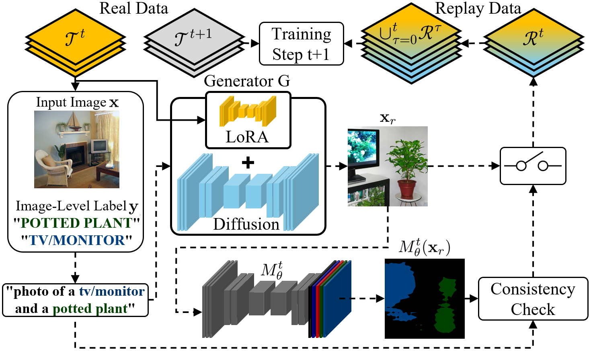
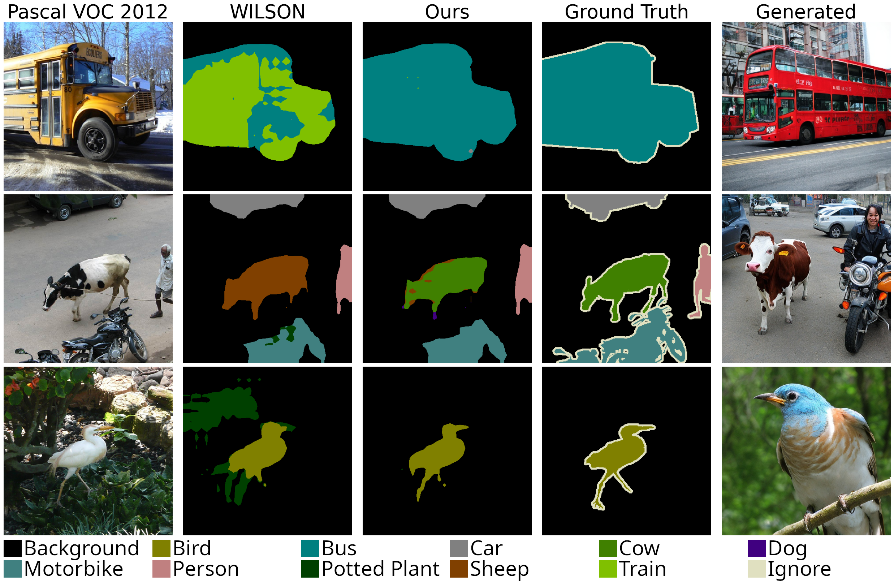

<div align="center">

# DR.WILSS: Diffusion-Based Replay for Weakly </br> Supervised Continual Semantic Segmentation
### Leon Arthur Marx, Francesco Barbato, Matteo Caligiuri, Pietro Zanuttigh </br></br> MMSP 2026

</div>



## Abstract
Weakly supervised class-incremental semantic segmentation (WILSS) aims to train a segmentation model over multiple steps, each introducing new concepts to be learned with only image-level supervision. We introduce DR.WILSS, an innovative approach to address catastrophic forgetting in continual learning using diffusion-based generative replay. Our framework leverages language clues to guide the diffusion process, employing self-inpainting and regularization techniques to efficiently produce replay data, aiding the learning process. By generating high-quality replay data, the information from previously learned classes can be preserved during continual updates, a critical challenge in incremental learning scenarios. To further align the statistics of replay data with those of training samples, we apply LoRAs to the generative model. Experimental results demonstrate state-of-the-art performance across multiple benchmarks and generative architectures, while avoiding storage of training data and the use of additional resource-demanding tools during training. The proposed technique enables an optimal tradeoff between training complexity and inference-time accuracy, making DR.WILSS a promising solution for real-world applications.

## How to run

### Setup
In order to create a conda environment containing all necessary packages, run
```
conda create -n drwilss -c conda-forge python==3.14.2 pip=25.3 setuptools==80.9.0 gcc==15.2.0 gxx==15.2.0 -y
conda activate drwilss
./conda_env/make.sh
```
For different CUDA versions and architectures, change `conda_env/*`.

### Datasets 
In the benchmark there are two datasets: Pascal-VOC 2012 and COCO (object only).
For the COCO dataset, we followed the COCO-stuff splits and annotations, that you can see [here](https://github.com/nightrome/cocostuff/).

To download datasets, run
```
./data/download_voc.sh
./data/download_coco.sh
PYTHONPATH=. python ./data/preprocess_coco.py
```

### ImageNet Pretrained Models
After preparing the data, download the models pretrained on ImageNet using [InPlaceABN](https://github.com/mapillary/inplace_abn).
Download the [ResNet-101 IABN Sync](https://drive.google.com/file/d/1oFVSIUYAxa_uNDq2OLkbhyiFmKwnYzpt/view) model for Pascal-VOC 2012, and the [WideResNet-38 IABN](https://drive.google.com/file/d/1Y0McSz9InDSxMEcBylAbCv1gvyeaz8Ij/view) model for COCO-to-VOC, and save them in the `pretrained` folder.

### Run!
We provide different example scripts to run the experiments (see `voc.sh`, `cocovoc.sh`).

To replicate our results (for example) on the 15-5 overlapped scenario in Pascal VOC 2012, run
```
# LoRA Training
python prepare_data.py voc 15-5 overlap all shuffle full "photo of a CLASS" 42
python select_top_k.py voc 15-5 overlap all 10 42
./train_lora.sh 15-5-ov_top_10 all 128 1e-5 50 42

# Segmentation
./voc.sh 15-5 overlap all DRWILSS_42 Base_42 replay_data_42 0.5 42 4 shuffle gen sd21_lora 16 512 50 'photo of a CLASS' 'none' 'true'
```

Similarly, for the COCO-to-VOC scenario, run
```
# LoRA Training
python prepare_data.py coco-voc voc disjoint all shuffle full "photo of a CLASS" 42
python select_top_k.py coco-voc voc disjoint all 10 42
./train_lora.sh voc_top_10 0 128 1e-5 50 42

# Segmentation
./cocovoc.sh all DRWILSS_42 Base_42 replay_data_42 0.5 42 4 shuffle gen sd21_lora 16 512 50 'photo of a CLASS' 'none' 'true'
```
In order to replicate WILSON (assuming the `Base` model from step 0 already exists), run
```
./voc.sh 15-5 overlap incr WILSON_42 Base_42 "" 0 42

./cocovoc.sh incr WILSON_42 Base_42 "" 0 42
```
For the reference runs using past training data for replay instead of generated data, run
```
./voc.sh 15-5 overlap incr REFERENCE_42 Base_42 replay_data_ref_42 0.5 42 0 noshuffle real none 0 0 0 'photo of a CLASS' 'none' 'true'

./cocovoc.sh incr REFERENCE_42 Base_42 replay_data_ref_42 0.5 42 0 noshuffle real none 0 0 0 'photo of a CLASS' 'none' 'true'
```
Replay without LoRA modules can be run by passing e.g. `sd21` instead of `sd21_lora` to `voc.sh` and `cocovoc.sh`, as well as adjusting the run name and replay directory.
A more detailed list of arguments is given in the respective scripts.

## Qualitative Results

Qualitative results for the overlapped 15-5 scenario.

## 

This code was built on [WILSON](https://github.com/fcdl94/WILSON).